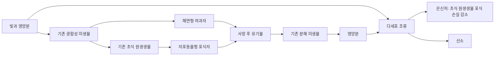

# v0.2 설계 결정

2026-10-17 · ORIGIN-LAB-V02

첨부 초안의 범위 내에서 10개 조합, 3종 생물, 2개 관찰, 조간대 1곳을 선택했다. 24개 기존 조합은 그대로 두며, 추가 조합은 첫 장 완료 후 별도 진입으로만 열린다. 첫 장의 이전 환생 기록도 완료의 증거로 취급한다.

## 선택 근거

1. **도달성**: 기존의 연안 환경·세포막·연안 군체·대사 순환·광합성·감각 반응·초식 원생생물·공생에서 출발한다. 신규 그래프는 순환 의존이 없다. 마지막 조합만 새 관찰 2개를 요구한다.
2. **관찰 밀도**: 입장 즉시 무료 조합 후보 두 개가 있다. 재시작이나 새 자원 생산 대기를 요구하지 않는다. 발견한 생물을 보충하면 5초 반응 관찰 뒤 기록할 수 있다. 빛을 바꾸고 다시 5초를 관찰하는 비교 루프다.
3. **실제 영향**: 생산자 1종, 여과자 1종, 포식자 1종을 추가해 기존 미생물·초식 원생생물·분해 미생물과 연결한다. ‘조류의 은신처’는 실제 포식량을 줄이며, 물 교환은 영양분 증가와 유기물 유실을 동시에 일으킨다.
4. **범위**: 새 엔진이나 긴 캠페인 대신 기존 생태계 계산을 세 번째 서식지로 확장했다. 시각 장식용 종을 추가하지 않았다.
5. **과학**: 조류 → 해면 → 자포동물을 직계 조상 순서로 표현하지 않는다. 다세포성의 여러 독립 기원, 실제 동물의 다양한 먹이와 행동, 짧은 공존과 장기 안정성의 차이를 설명한다. 해면형·자포동물형이라는 기능 모형 표현을 사용한다.

## 생태계 연결

빛은 조간대의 광합성 생물 섭식 충족률을 밝음 1, 그늘 0.3으로 조절한다. 이 값은 번식과 산소 생산에 함께 반영된다. 기존 첫 장 서식지에는 적용하지 않는다. 화면의 여과·포식·분해 수치는 해당 tick에 실제 소비한 양에서 계산한다.

무료 보충은 새로운 관찰을 준비하는 조작이다. 조간대에서 발견한 생물의 최소 표본 수와 산소·자원을 보충하며, 다른 서식지의 개체 수를 덮어쓰지 않는다. 실제 자연에서는 실험자가 이렇게 즉시 개입할 수 없다는 게임적 한계를 문구로 드러낸다.

## 보상과 종료

- 기존 재화와 연구는 회수하지 않는다.
- 첫 장 +3 보상은 첫 재시작 한 번만 지급한다. 과거 환생이 있으면 이미 받은 것으로 이전한다.
- 첫 장 최종 실험 기록을 영구 보존한다. 새 장에 들어가기 위해 재실험하지 않는다.
- 새 관찰 두 개에 +2씩, 계정 저장 내 고유 성취로 지급한다. 관찰 반복·다시 불러오기·재시작으로 보상을 늘리지 않는다.
- 첫 장과 둘째 장 모두 ‘여기서 마치기’를 제공하고 계속 관찰할 수 있다.

## 범위 밖 제안

더 긴 탐험을 원한다면 추가 종 수보다 같은 생태계를 비교할 조건별 기록표, 기록 그래프, 관찰 과제 변형을 먼저 사용자 테스트로 검토한다. 동물의 실제 계통도·지질시대 재현, 온라인 저장, 계정 시스템, 외부 배포는 이번 버전에 포함하지 않았다.
